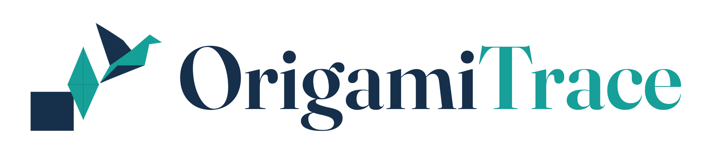

<p align="center">
  
</p>

<h2 align="center">Origami as a Real-Image Benchmark<br> for Procedural State-Transition Reasoning</h2>

<p align="center">
  <a href="https://tohoku-nlp.github.io/OrigamiTrace/"></a>
  <a href="https://doi.org/10.7910/DVN/V6T9LX"></a>
  <a href="https://neurips.cc/virtual/2026/loc/sydney/poster/139109"></a>
  <a href="LICENSE"></a>
</p>

This repository contains the simulator-based evaluation used in our NeurIPS 2026 (Evaluations and Datasets Track) paper, *Origami as a Real-Image Benchmark for Procedural State-Transition Reasoning*: the evaluation interface (Task 1 and Task 2), the prompts and command specification sent to the LLM controllers, and the list of sampled episodes.
The dataset itself is distributed separately through Harvard Dataverse: https://doi.org/10.7910/DVN/V6T9LX

## Quick start

Requirements: Node.js 20 or later.
Three sample works from the dataset are included in `examples/data/`, so the interface runs without downloading the dataset.

1. Get the code and install the dependencies:

   ```bash
   git clone https://github.com/tohoku-nlp/OrigamiTrace.git
   cd OrigamiTrace
   npm install
   ```

2. Copy `.env.example` to `.env` and set the API keys of the controllers you use:

   ```bash
   cp .env.example .env   # OPENAI_API_KEY for GPT 5.6 Sol, AWS_BEARER_TOKEN_BEDROCK for the Gemma models
   ```

   Controllers whose keys are not set are listed as unavailable, together with the variables to set, so you can check the keys on the start screen.
   To evaluate other models, see [Evaluating other models](#evaluating-other-models).

3. Start the server:

   ```bash
   npm start
   ```

   To use another port, run `npm start -- --port <n>`.

4. Open http://127.0.0.1:4174/.
   Under **New episode**, choose the task, the controller and the episode, and press **Start**.
   The episode then opens on its own page, where you get each model output and judge it (see [Evaluation protocol](#evaluation-protocol)).
   Each episode is saved to `logs/<episode id>.json` after every action and listed under **Episodes**, from which it can be resumed or reviewed.

## Running on the full dataset

1. Download the dataset from Dataverse and extract the image archives, so that the directory looks like this:

   ```text
   <data>/
     images/001_Long-Horned_Samurai_Helmet/001_Long-Horned_Samurai_Helmet__01.jpg ...
     texts/001_Long-Horned_Samurai_Helmet.csv ...
   ```

2. Generate the display images for the judging interface:

   ```bash
   pip install -r requirements.txt
   python tools/normalize_coordinates.py <data>
   ```

   This writes the images with the coordinate frame drawn on them to `<data>/display/`, used only to show the commands to the evaluator.

3. Start the server on that directory:

   ```bash
   npm start -- --data <data>
   ```

## Evaluation protocol

`episodes.csv` lists the 348 sampled episodes: a work, its start state, and a target state at most 10 transitions later.

At each transition, the controller receives the current state image and returns simulator commands in JSON. A human evaluator judges each attempt from the command markers drawn on the image:

- **Correct**: go to the next transition.
- **Incorrect**: valid commands that do not perform the intended operation.
- **Invalid**: the response breaks the command specification (detected automatically).

Incorrect and invalid responses count as failed attempts. An episode ends when the target state is reached or when a transition fails three times.

- **Task 1 (autonomous).** The first request sends all reference images of the segment and all textual entries as one CSV file. Each transition then sends the current image and its textual entry. Failed attempts receive the fixed feedback in `messages/`.
- **Task 2 (human-guided).** The controller does not see the reference procedure. An instructor writes the instruction for each transition, and a correction or format feedback after a failed attempt. The instructor may answer clarification questions from the controller; answered questions are not counted as attempts.

### Controllers

| Controller | API |
| --- | --- |
| GPT 5.6 Sol (`gpt-5.6-sol`) | OpenAI API |
| Gemma 4 31B (`google.gemma-4-31b`) | Amazon Bedrock |
| Gemma 3 12B IT (`google.gemma-3-12b-it`) | Amazon Bedrock |

All controllers use the same prompts, images and protocol. Their settings are in `models.json`.

### Evaluating other models

Add an entry to `models.json` (or pass another file with `--models <file>`) and set its API key in `.env`. The model must accept multiple images in one request.

```json
{
  "id": "Qwen/Qwen3-VL-8B-Instruct",
  "label": "Qwen3-VL 8B",
  "api": "openai-chat",
  "endpoint": "http://localhost:8000/v1/chat/completions",
  "parameters": { "max_tokens": 2048, "temperature": 0 }
}
```

| Field | Meaning |
| --- | --- |
| `id` | Model name sent to the API, also recorded in the logs (must be unique). |
| `label` | Name shown in the interface (default: `id`). |
| `api` | `openai-chat` (OpenAI Chat Completions API and compatible servers) or `bedrock-converse` (Amazon Bedrock Converse API). |
| `endpoint` | Request URL. `${NAME}` and `${NAME:-default}` are replaced with environment variables. |
| `apiKeyEnv` | Environment variable holding the API key. Omit it if no key is needed. |
| `parameters` | Merged into the request body (e.g., `max_tokens`, `temperature`). |
| `timeoutSeconds` | Request timeout (default: 300). |

Other APIs can be supported by adding an adapter to `APIS` in `server/models.mjs`.

### Prompts

The system prompt is `instructions/task_<N>.md` followed by the command specification and examples in `knowledge/`.

## Repository structure

```text
.
├─ episodes.csv            # sampled episodes (work ID, start state, target state)
├─ models.json             # LLM controllers (API, endpoint, decoding settings)
├─ instructions/           # system prompts for Task 1 and Task 2
├─ knowledge/              # command specification and command examples
├─ messages/               # fixed messages in Task 1
├─ server/                 # evaluation server (episode protocol, model APIs, command format check)
├─ web/                    # judging interface
│   ├─ app.js              #   routing, actions, and events
│   ├─ state.js            #   client state shared by the views
│   ├─ timer.js            #   working time and pause
│   ├─ plot.js             #   command markers drawn on the state image
│   └─ views/              #   screens: episode list, Task 1 initialization, judging, result
├─ tools/                  # display images with the normalized coordinate frame (+ verified frames)
├─ examples/data/          # three sample works in the Dataverse layout
├─ test/                   # npm test
└─ docs/                   # project page
```

## Citation

```bibtex
@inproceedings{numaya2026origamitrace,
  title     = {Origami as a Real-Image Benchmark for Procedural State-Transition Reasoning},
  author    = {Ikumi Numaya and Reina Akama and Kise Yoshida and Yuka Saito and
               Sumika Tsuda and Takahiro Shimizu and Miori Sagara and Jun Suzuki},
  booktitle = {The Fortieth Annual Conference on Neural Information Processing Systems
               Evaluations and Datasets Track},
  year      = {2026}
}
```

## License

The code is released under the [MIT License](LICENSE).
The sample images and textual entries in `examples/data/` are part of the OrigamiTrace dataset, licensed under CC BY-SA 4.0.
